<p align="center">
  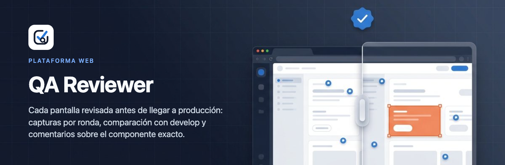
</p>

<p align="center">
  
  
  
  
  
</p>

# QA Reviewer · plataforma web

**Diseño (UI/UX) revisa los cambios visuales del frontend antes de que lleguen a producción.**

El dev ejecuta `/design-review` en su sesión de Claude Code. La skill captura las pantallas que tocó la feature (antes y después, de 1024 a 1440 px), redacta qué mirar en cada una y sube el paquete. Diseño revisa pantalla por pantalla, aprueba o pide ajustes sobre el componente exacto, y el feedback vuelve al PR de GitHub, a la tarjeta de Plane y a la sesión del dev. Cada corrección es una ronda nueva: solo se vuelve a revisar lo que cambió.

<p align="center">
  
</p>

## Cómo funciona

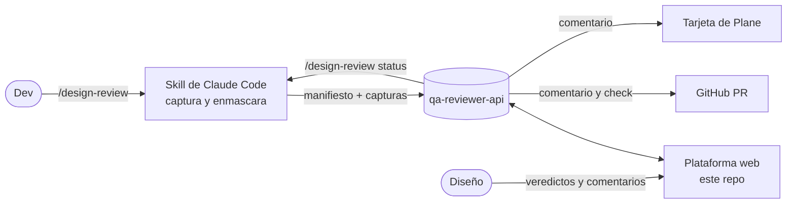

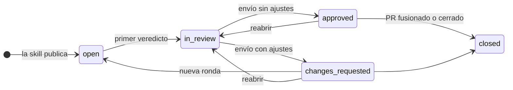

## Recorrido

|                                                                                                  |                                                                                                          |
| :----------------------------------------------------------------------------------------------: | :------------------------------------------------------------------------------------------------------: |
|         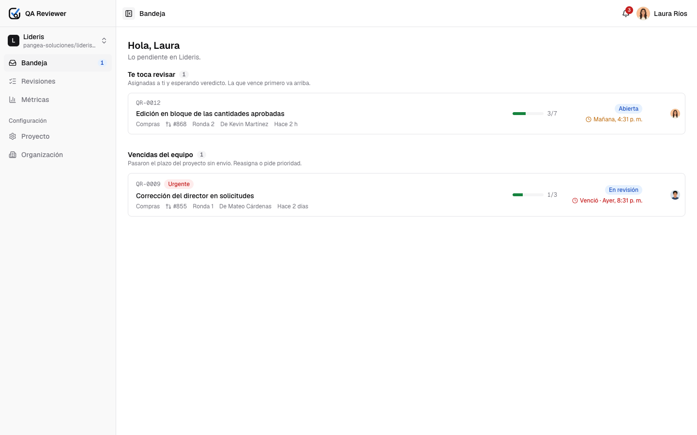         |          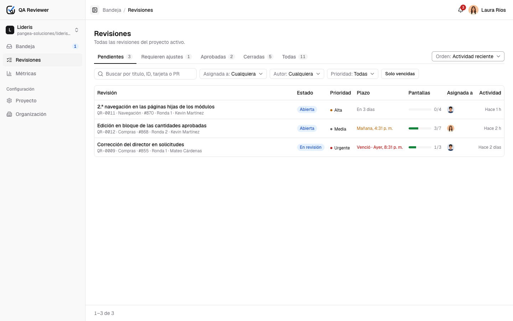          |
|             **Bandeja.** Lo que te toca revisar y lo vencido del equipo, por plazo.              |             **Revisiones.** Filtros, orden y página en la URL; tabla con scroll horizontal.              |
|  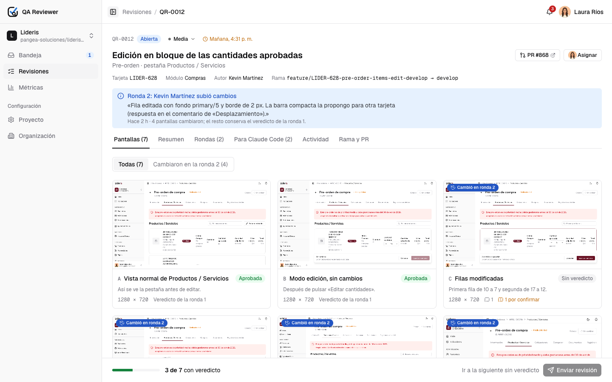  |       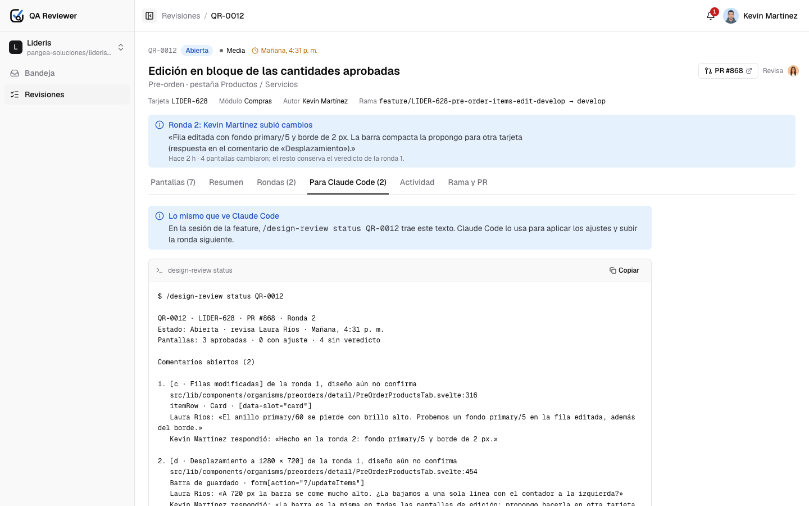        |
|        **Detalle.** Pantallas de la ronda, qué cambió, veredictos y envío de la revisión.        | **Para Claude Code.** El mismo texto que recibe el dev con `/design-review status`, con archivo y línea. |
|        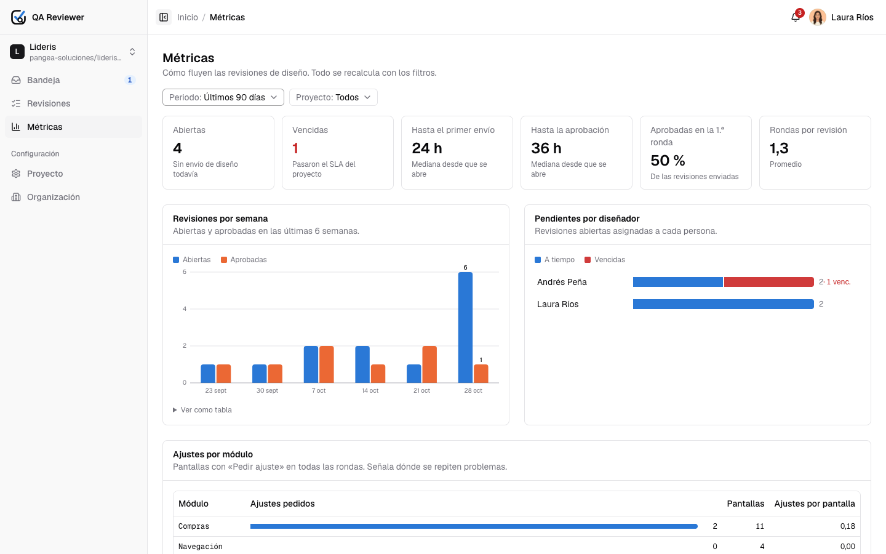        |     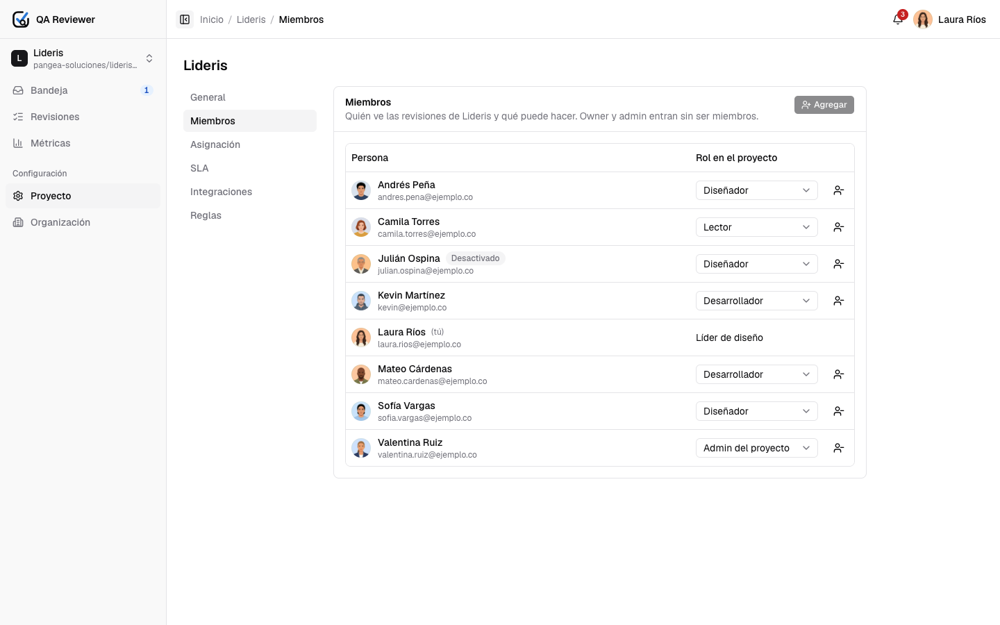      |
| **Métricas.** Tiempo al primer envío y a la aprobación, carga por diseñador, ajustes por módulo. |      **Proyecto.** Miembros y roles, asignación automática, SLA, integraciones y reglas de diseño.       |
|         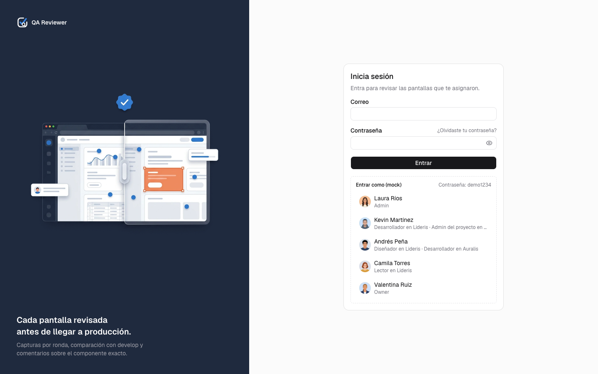          |            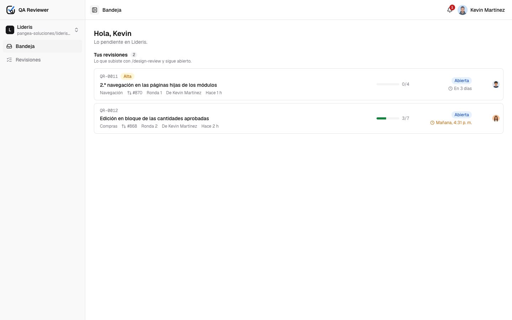            |
|        **Acceso.** Usuario y contraseña con invitación; en modo mock, entrar con un clic.        |                    **Bandeja del dev.** Sus revisiones abiertas y en qué va cada una.                    |

> Las capturas salen de la app con los datos sintéticos del mock (`pnpm readme:shots`). Las pantallas de producto que aparecen dentro del visor están anonimizadas.

## Piezas

| Pieza                      | Repo                                                                    | Stack                                                                     |
| -------------------------- | ----------------------------------------------------------------------- | ------------------------------------------------------------------------- |
| Plataforma web (este repo) | `qa-reviewer`                                                           | SvelteKit 2 + Svelte 5 (runes) + TypeScript + Tailwind v4 + shadcn-svelte |
| API                        | [`qa-reviewer-api`](https://github.com/kevin-martineze/qa-reviewer-api) | NestJS 11 + Fastify + MongoDB (Mongoose) + S3                             |
| Skill de captura           | `qa-reviewer-api/skill` (en construcción)                               | Skill de Claude Code + Playwright                                         |

La web nunca habla con la base de datos ni con el storage: solo con el API, y siempre desde el servidor de SvelteKit. Las rutas dependen de puertos (`$lib/api/ports.ts`); `REVIEWS_SOURCE` elige el adaptador: `mock` (API en memoria con las mismas reglas) o `api`.

## Arrancar

Requisitos: Node 22 y pnpm 10.

```bash
pnpm install
pnpm dev                      # con el mock en memoria (sin API): http://localhost:5173
```

Contra el API real:

```bash
# en qa-reviewer-api
pnpm demo                     # API + Mongo en memoria + datos de demo en :3000
# en este repo
REVIEWS_SOURCE=api API_URL=http://localhost:3000 pnpm dev
```

Cuentas de demo (contraseña `demo1234`, solo en el mock y en la semilla del API):

| Cuenta                      | Rol                                        |
| --------------------------- | ------------------------------------------ |
| `laura.rios@ejemplo.co`     | Admin de la organización · líder de diseño |
| `kevin@ejemplo.co`          | Developer en Lideris · admin en Auralis    |
| `andres.pena@ejemplo.co`    | Diseñador                                  |
| `camila.torres@ejemplo.co`  | Lectora                                    |
| `valentina.ruiz@ejemplo.co` | Owner                                      |

## Scripts

| Comando                                    | Qué hace                                                                              |
| ------------------------------------------ | ------------------------------------------------------------------------------------- |
| `pnpm dev`                                 | Servidor de desarrollo                                                                |
| `pnpm build` · `pnpm preview`              | Build de producción (Vercel) y vista previa                                           |
| `pnpm check` · `pnpm lint` · `pnpm format` | svelte-check, ESLint y Prettier                                                       |
| `pnpm test`                                | Pruebas unitarias (Vitest) de dominio, esquemas y adaptadores                         |
| `pnpm test:e2e`                            | E2E con Playwright contra el mock                                                     |
| `pnpm seed:export`                         | Exporta los datos del mock como semilla de demo del API (`qa-reviewer-api/seed/demo`) |
| `pnpm readme:shots`                        | Regenera las capturas y el banner de este README                                      |

## Estructura

```
src/
├── routes/
│   ├── (public)/           login, invitación, recuperación (sin sesión)
│   └── (app)/              bandeja, revisiones, visor, métricas, ajustes, administración
├── lib/
│   ├── api/                contrato (types), puertos (ports) y Result
│   ├── server/             gateway, guards, adaptadores http y mock
│   ├── domain/             lógica pura con pruebas (consultas, plazos, permisos, métricas)
│   ├── schemas/            zod por entidad (formularios y actions)
│   └── components/         atoms → molecules → organisms → templates (+ ui de shadcn)
e2e/                        specs de Playwright
docs/                       PRD, arquitectura, ADR y assets del README
scripts/                    anonimizado de capturas, export de la semilla, capturas del README
```

## Hoja de ruta

| Fase | Entrega                                                                                  | Estado    |
| ---- | ---------------------------------------------------------------------------------------- | --------- |
| 1    | Web completa contra el mock: revisión, visor, rondas, feedback, métricas, ajustes, admin | Hecho     |
| 2    | API: sesión, cuenta, invitaciones, recuperación, storage, correo, outbox                 | Hecho     |
| 3    | API: semilla de demo compartida con el mock                                              | En curso  |
| 4    | API: organización, proyectos, revisiones, feedback, notificaciones, tokens, métricas     | Pendiente |
| 5    | E2E de la web también contra el API real; tipos generados desde OpenAPI                  | Pendiente |
| 6    | Skill `/design-review`: captura, enmascarado, manifiesto, rondas y `status`              | Pendiente |
| 7    | Integraciones: comentario y check en GitHub, comentario en Plane, correo; jobs de plazos | Pendiente |
| 8    | CI en ambos repos y despliegue (web en Vercel, API con Mongo y S3)                       | Pendiente |

Después de la versión 1: eventos en tiempo real, login con GitHub o Google, móvil y tablet.

## Documentación

- [Requisitos del producto (PRD)](docs/product/prd.md)
- [Visión general y flujos](docs/architecture/README.md) · [dominio y manifiesto](docs/architecture/domain.md) · [usuarios y roles](docs/architecture/users-and-roles.md)
- [Contrato del API](docs/architecture/api.md)
- [Arquitectura del frontend](docs/architecture/frontend.md) · [layouts](docs/architecture/layouts.md) · [patrones](docs/architecture/patterns.md) · [algoritmos](docs/architecture/algorithms.md)
- [Seguridad y privacidad](docs/architecture/security.md)
- [Decisiones (ADR)](docs/adr/README.md)
- [Guía para escribir código](CLAUDE.md)
- Backend: [documentación de `qa-reviewer-api`](https://github.com/kevin-martineze/qa-reviewer-api/tree/main/docs)

> El repo es público: nunca subas capturas con datos reales, tokens ni archivos `.env`.
